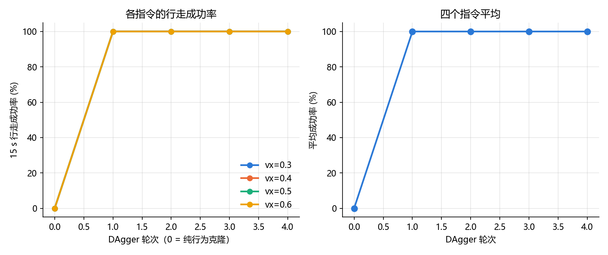

# T800 DAgger 实验报告

## 1. 实验目的

阶段 1 的行为克隆（BC）在老师走过的状态上动作误差只有 0.024（老师动作标准差的 2%），
但一闭环就必摔。本阶段尝试用 DAgger 缓解这个问题：让学生自己走，把它走到的状态交给老师打标签，
再把这些"学生的状态 + 老师的动作"并进数据集重新训练。

DAgger 之后还要回答一个更重要的问题：**学生是不是真的能替代老师**？所以本报告把学生和老师放在
完全相同条件下比较三项能力：速度跟踪、行走中抗推、动作延迟。抗推和延迟这两项，正是阶段 3 要改进的目标。

## 2. 实验条件

| 项目 | 设置 |
|---|---|
| 仿真环境 | MuJoCo 3.4，平地，地面摩擦系数 1.0 |
| 机器人 | T800 人形机器人，25 个关节，整机质量 84.9 kg |
| 老师 | 官方预训练模型 `t800_260318_150533_60000.mnn`，观测 1083 维、动作 22 维 |
| 学生 | MLP 1083 → 512 → 256 → 22，ELU，MSE 损失，Adam，学习率 1e-3，批大小 1024 |
| 训练环境 | CPU（PyTorch 2.15.0+cpu），无 GPU |
| 控制频率 | 策略 100 Hz，PD 500 Hz（仿真步长 0.002 s），观测 / 动作 / 常量与 [25_t800_robustness.py](25_t800_robustness.py) 完全一致 |
| 摔倒判断 | 根部高度低于 0.6 m，或机身倾斜超过 45° |
| 评测重复次数 | 每档 10 个种子（种子 0~9），每次 15 s，前 3 s 不计入速度统计 |

**基准核对**：本报告的"老师"一列和已有的四份报告逐项对得上（速度 0.268/0.346/0.461/0.531 m/s、
抗推 450/500/300/150 N、延迟 40 ms 不摔 50 ms 全摔），说明对比条件没有漂移。

## 3. 方法

### 3.1 阶段 1 的基线（纯行为克隆，[26](26_t800_collect.py) + [27](27_t800_bc_train.py)）

老师数据：200 个回合 × 15 s = 298,232 步，其中 2 个回合摔倒（不参与训练）。
每个回合随机化：vx ~ U(0.3, 0.6)、初始关节角 ±0.10 rad、途中随机推 0~3 次（40~120 N，0.2 s）。
训练 60 轮，按回合划分训练 / 验证，最好验证 MSE 5.5e-4。

### 3.2 DAgger（[28_t800_dagger.py](28_t800_dagger.py)）

每一轮：

1. **让学生自己控制**（它会走到自己才会犯错的状态），每一步把这个状态交给老师打标签，
   记录 `72 维单帧 + 老师的动作标签 + 指令`；摔倒就重置继续采集，直到凑够 60,000 步；
2. 把这一轮数据并入数据集（老师数据 298k 步 + 各轮 60k 步），重新训练 30 轮；
3. 用 25 的 `run_trial(policy=学生)` 评测：vx = 0.3 / 0.4 / 0.5 / 0.6，每档 5 个种子。

重复 4 轮。第 0 轮就是阶段 1 的纯 BC 权重，作为对照。

**为什么摔倒后要重置继续采**：学生每 4~7 s 就摔一次（见诊断），如果一摔就结束这一回合，
采到的大多是"摔倒前"的数据；重置后继续采集可以把"摔倒过程中的状态"也拿到，
这些状态恰恰是老师数据里最缺的。

## 4. 结果

### 4.1 每一轮的成功率（自己走）

| 轮次 | 本轮采集步数 | 验证 MSE | vx=0.3 | vx=0.4 | vx=0.5 | vx=0.6 | 平均摔倒率 | vx=0.5 实际速度 |
|---:|---:|---:|---:|---:|---:|---:|---:|---:|
| 0（纯行为克隆） | 0 | 5.45e-4 | 100% | 100% | 100% | 100% | 100% | — |
| 1 | 60,474 | 8.68e-3 | 0% | 0% | 0% | 0% | **0%** | 0.351 |
| 2 | 61,324 | 1.19e-2 | 0% | 0% | 0% | 0% | 0% | 0.442 |
| 3 | 60,000 | 7.32e-3 | 0% | 0% | 0% | 0% | 0% | 0.408 |
| 4 | 61,045 | 5.90e-3 | 0% | 0% | 0% | 0% | 0% | 0.461 |

- **在 vx 0.3~0.6、无扰动条件下，DAgger 把摔倒率从 100% 降到 0%**；第 1 轮就已经是 0%，
  后面三轮主要改善行走质量（vx=0.5 的实际速度从 0.351 提到 0.461 m/s，与老师的 0.461 相同）。
- **验证 MSE 不能横向比较**：每一轮的数据集不同（不断并入学生自己的状态），验证回合里既有老师轨迹
  也有学生轨迹，所以第 1 轮的 8.68e-3 大于纯 BC 的 5.45e-4，并不代表模型变差，而是在更难的验证集上算的。
- 采集量说明：每轮补齐到 6 万步，而学生每次只能走几百到一千多步，所以一轮里要重置几十次。

### 4.2 速度跟踪（老师 vs 学生，每档 10 个种子）

| 指令 vx | 老师 实际vx | 老师 误差 | 老师 摔倒率 | 学生 实际vx | 学生 误差 | 学生 摔倒率 |
|---:|---:|---:|---:|---:|---:|---:|
| 0.3 | 0.269 | 0.031 | 0% | 0.296 | 0.004 | 0% |
| 0.4 | 0.346 | 0.054 | 0% | 0.377 | 0.023 | 0% |
| 0.5 | 0.461 | 0.039 | 0% | 0.463 | 0.037 | 0% |
| 0.6 | 0.531 | 0.069 | 0% | 0.509 | 0.091 | 0% |

**四档指令下两者都能稳定行走，跟踪误差与老师相当**（0.3 / 0.4 档误差更小，0.5 档基本相同，
0.6 档略差约 0.02 m/s）。0.6 档偏差较大的原因是"该档训练样本少"，属**未验证的推测**。

### 4.3 行走中抗推（0.5 m/s，推 0.2 s，每档 10 个种子）

| 方向 | 老师 | 学生 | 学生 / 老师 |
|---|---:|---:|---:|
| 向前 (+x) | 450 N | 350 N | 78% |
| 向后 (−x) | 500 N | 350 N | 70% |
| 向左 (+y) | 300 N | 200 N | 67% |
| 向右 (−y) | 150 N | 175 N | 117% |

- **学生四个方向里有三个明显弱于老师**；只有向右（老师最弱的方向）略高，但只差一档（25 N），
  落在实验不确定性范围内，**不能认为是有意义的差异**。
- **失效曲线形状不同**：老师的成功率随推力增大缓慢下降并带很长拖尾（向前 450 N 为 80%、
  575 N 仍有 10%；向右 175~500 N 一直维持 50%~70%），即推力过大时偶尔还能靠步态相位救回来；
  学生是台阶式的，超过临界推力后迅速掉到 0%。逐档数据见 `results/compare_push.csv`。

### 4.4 动作延迟（0.5 m/s，每档 10 个种子）

| 设定延迟 | 实际延迟 | 老师 摔倒率 | 老师 实际vx | 学生 摔倒率 | 学生 实际vx |
|---:|---:|---:|---:|---:|---:|
| 0 ms | 0 ms | 0% | 0.461 | 0% | 0.463 |
| 10 ms | 10 ms | 0% | 0.510 | 0% | 0.461 |
| 20 ms | 20 ms | 0% | 0.556 | 0% | 0.376 |
| 30 ms | 30 ms | 0% | 0.600 | **100%** | — |
| 40 ms | 40 ms | 0% | 0.557 | **100%** | — |
| 45 ms | 44 ms | **70%** | 0.333 | 100% | — |
| 50 ms | 50 ms | 100% | — | 100% | — |
| 60 ms | 60 ms | 100% | — | 100% | — |

- 45 ms 这一档单独补测，因为 [延迟与噪声实验报告.md](延迟与噪声实验报告.md) 里这一档的摔倒率是 60%
  （5 个种子）；本次 10 个种子的结果是 70%，两档都在"临界"范围内，和报告一致。
  延迟要换算成整数个仿真步（每步 2 ms）：45 ms → 44 ms，50 ms 及以上不变。
- **学生的延迟容忍度约为 20 ms，只有老师（约 40 ms）的一半**：30 ms 起就 100% 摔倒。
- 延迟增大时两者的速度变化方向相反：老师 0→30 ms 由 0.461 涨到 0.600 m/s，学生 0→20 ms 由 0.463 降到 0.376 m/s。
  逐档数据见 `results/compare_latency.csv`。

## 5. 不足

1. **抗推和延迟每档只有 10 个种子**，临界区（成功率 70%~90%）本身就在跳动，临界推力有 ±1 档（±25 N）的不确定性。
2. **推的时刻仍由种子决定**（5~6 s 之间随机），10 个种子只覆盖 10 个时机。抗推报告第三版已经证明侧向结果对时机极其敏感，
   所以侧向的 200 / 175 N 只代表"这 10 个时机的水平"，不是理论上限。
3. **抗推和延迟只在 0.5 m/s、平地、默认摩擦下测**，没有和负载、摩擦、推力组合。
4. **验证 MSE 跨轮不可比**：每轮数据集都在变，且验证回合混有老师轨迹和学生轨迹，
   所以无法用它判断"学生对老师动作的拟合"是否在变好。
5. **没有做多种子训练**：DAgger 只训练了 1 组（种子固定），第 2、3 轮 vx=0.5 的实际速度在 0.442 / 0.408 之间波动，
   无法区分是"轮次真有影响"还是训练随机性。
6. **学生完全没有在延迟条件下训练过**，所以 20 ms 这个数字只是"没被训练过的能力"的体现，不代表网络容量上限。
7. **只在仿真中验证**，没有真机实验。

## 6. 结论

1. **在 vx 0.3~0.6 m/s、无扰动条件下，DAgger 把纯行为克隆的 100% 摔倒降到 0%**，
   而且第 1 轮就达到；后续轮次主要提升行走质量（vx=0.5 实际速度 0.351 → 0.461 m/s，与老师相同）。
2. **速度跟踪与老师相当**：0.3 / 0.4 m/s 档误差更小（0.004 / 0.023 vs 0.031 / 0.054），
   0.5 m/s 基本相同（0.037 vs 0.039），0.6 m/s 略差（0.091 vs 0.069）。
3. **抗推能力不及老师**：最大可恢复推力 向前 350 N、向后 350 N、向左 200 N、向右 175 N，
   对应老师的 450 / 500 / 300 / 150 N（三个方向只剩 67%~78%）。而且学生是台阶式失效，老师有长拖尾。
4. **延迟容忍度不及老师**：学生约 20 ms，老师约 40 ms（45 ms 时老师 70% 摔倒、学生 100%）。
5. 也就是说：**DAgger 让"在训练分布内行走"这件事达标了，但没有带来老师的鲁棒性**。
   阶段 3 的价值正在这里——必须靠专门的设计（而不是更多同分布数据）去超过老师。

## 7. 可能的原因（待验证）

- **学生抗推弱**：模仿学习学到的是"正常步态"，被推歪之后需要"主动调整落足点"这种恢复行为，
  而老师数据（以及 DAgger 数据）里这类样本的比例很低；加权或专门采集被推状态可能有用。
- **学生延迟敏感**：训练时 `delay_ms=0`，策略看到的"最新一帧"就是当前状态；延迟一大，输入和真实状态错位，
  历史里也缺少"延迟"这一信息。属于**未验证的推测**。
- **老师延迟下走得更快是在补偿延迟**：属于**未验证的推测**，需要对比不同延迟下的关节动作幅度/步长来检验（报告里已提出）。
- **学生没有学会这种补偿**：同样**未验证**，需要通过对比两者在延迟下的步频、步长验证。
- **0.6 m/s 档跟踪略差是因为该档训练样本少**：**未验证的推测**。

## 8. 本实验的局限

- 只在平地、默认摩擦、无负载条件下评测，没有测地形、摩擦、负载的组合。
- 学生网络固定为 MLP 1083 → 512 → 256 → 22，没有尝试更大/更小的容量，也没有比较其他结构。
- DAgger 只做了 4 轮、每轮 6 万步，没有测试"更多轮次 / 更多数据"是否还能继续提升抗推能力。
- 抗推、延迟的临界值都受 10 个种子的统计误差影响，报告里不做"精确到 25 N"的结论。
- 只在仿真中验证，没有真机实验。

## 9. 对阶段 3 的启示

学生的延迟上限（约 20 ms）低于老师的约 40 ms，而阶段 3 的目标是**把学生的延迟上限推到超过老师的约 40 ms**，
不只是把它补回 40 ms。要做到这一点，训练分布里必须包含延迟，并且要解决"观测里的历史帧与延迟错位"的问题。

**可以写进简历的一句话**：用 MuJoCo 采集 30 万步示范数据，用行为克隆 + 4 轮 DAgger（PyTorch，CPU 训练）
把学生策略在 vx 0.3~0.6 m/s 下的摔倒率从 100% 降到 0%、速度跟踪误差与官方策略相当（0.037 vs 0.039 m/s），
并量化出它在抗推（350/350/200/175 N）和动作延迟（约 20 ms）上仍明显弱于官方策略，作为下一步改进的基线。

