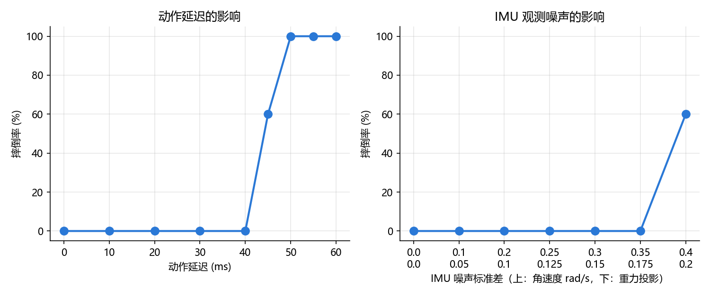

# T800 行走策略延迟与噪声实验报告

## 1. 实验目的

测试官方预训练的 RL 行走策略在"反应变慢"和"感觉不准"时还能不能走。这两类问题对应真机上的通信与驱动延迟、IMU 传感器误差，是策略从仿真搬到真机时最常遇到的问题。

## 2. 实验条件

以下条件在所有测试中保持不变。

| 项目 | 设置 |
|---|---|
| 仿真环境 | MuJoCo 3.4，平地，地面摩擦系数 1.0 |
| 机器人 | T800 人形机器人，25 个关节，整机质量 84.9 kg，不加负载 |
| 策略 | 官方预训练模型 `t800_260318_150533_60000.mnn`，策略推理 100 Hz（每 10 ms 一次），PD 控制 500 Hz（每 2 ms 一次） |
| 控制参数 | 默认站姿、PD 增益、动作缩放、力矩限幅均与官方 SDK 部署配置一致 |
| 行走指令 | vx = 0.5 m/s，vy = 0，开启航向闭环 |
| 仿真时长 | 每次 15 s，前 3 s 为起步阶段，不计入速度统计 |
| 重复次数 | 每组 5 次，初始关节角加 ±0.02 rad 随机扰动，随机种子为 0~4 |
| 摔倒判断 | 根部高度低于 0.6 m，或机身倾斜超过 45° |
| 外部干扰 | 无（不推、不改摩擦和负载） |

两种扰动每次只加一种，另一种保持为 0。

评测脚本：[25_t800_robustness.py](25_t800_robustness.py)，运行命令 `python 25_t800_robustness.py latency`。

## 3. 动作延迟

### 3.1 方法

PD 控制每 2 ms 计算一次力矩。加入延迟后，每次计算用的不是策略最新给出的目标角，而是若干毫秒之前的目标角。比如延迟 40 ms，电机执行的就是 40 ms 之前的指令。

需要注意的是，策略的观测中包含"上一帧动作"，它看到的是自己刚发出的指令，而不是电机正在执行的指令。因此延迟越大，策略以为的状态和机器人的实际状态差得越多。

延迟需要换算成整数个仿真步（每步 2 ms），换算时四舍五入：45 ms 实际是 44 ms，55 ms 实际是 56 ms，其余档位不受影响。

### 3.2 结果

| 设定延迟 | 实际延迟 | 摔倒率 | 实际 vx (m/s) |
|---|---:|---:|---:|
| 0 ms | 0 ms | 0% | 0.466 |
| 10 ms | 10 ms | 0% | 0.514 |
| 20 ms | 20 ms | 0% | 0.556 |
| 30 ms | 30 ms | 0% | 0.600 |
| 40 ms | 40 ms | 0% | 0.570 |
| 45 ms | 44 ms | 60% | 0.323 |
| 50 ms | 50 ms | 100% | — |
| 55 ms | 56 ms | 100% | — |
| 60 ms | 60 ms | 100% | — |

实际 vx 只统计没摔的那几次。44 ms 那一档只有 2 次没摔，速度参考价值不大。

### 3.3 观察

1. **边界在 40~50 ms 之间，过渡区很窄**：40 ms 时 5 次都没摔，44 ms 时摔 3 次，50 ms 及以上全摔。策略每 10 ms 决策一次，40 ms 相当于电机一直落后 4 次决策。
2. **延迟越大，走得越快**：0~30 ms 之间，实际速度从 0.466 涨到 0.600 m/s，超出指令 20%。摩擦与负载实验中，负载越接近边界机器人也走得越快，两者可能是同一类失效前兆。

## 4. IMU 噪声

### 4.1 方法

在策略看到的两项 IMU 观测上加高斯随机噪声：

- **角速度**：机身转动的快慢，单位 rad/s。
- **重力投影**：重力方向在机身坐标系下的投影，反映机身倾斜了多少，无单位，范围 −1~1。

两项噪声按固定比例同时加大，重力投影的标准差始终是角速度的一半。噪声只加在策略看到的观测上，摔倒判断仍然用真实状态。

### 4.2 结果

结果图见第 3.2 节右半部分。

| 角速度噪声 σ (rad/s) | 重力投影噪声 σ | 摔倒率 | 实际 vx (m/s) | 实际 / 指令 |
|---:|---:|---:|---:|---:|
| 0 | 0 | 0% | 0.466 | 93% |
| 0.1 | 0.05 | 0% | 0.409 | 82% |
| 0.2 | 0.1 | 0% | 0.327 | 65% |
| 0.25 | 0.125 | 0% | 0.308 | 62% |
| 0.3 | 0.15 | 0% | 0.291 | 58% |
| 0.35 | 0.175 | 0% | 0.243 | 49% |
| 0.4 | 0.2 | 60% | 0.228 | 46% |

### 4.3 观察

1. **策略对随机噪声的承受能力很强**：角速度噪声 σ 到 0.35 rad/s 时还能走，0.4 rad/s 时才开始摔。一般 IMU 的随机噪声要小得多。
2. **噪声的影响先体现在速度上**：噪声一加速度就开始下降，σ = 0.35 时只剩 0.243 m/s，不到指令的一半。摔倒率为 0% 不代表没受影响。
3. **延迟和噪声对速度的影响方向相反**：延迟让机器人走得更快，噪声让机器人走得更慢。

## 5. 不足

1. **延迟只加在执行端**：真机上，传感器读数传给策略同样有延迟（观测延迟），两种延迟的影响可能不同，本实验只测了执行端一种。
2. **两种噪声绑在一起加**：角速度和重力投影的噪声同时加大，分不清是哪一项导致速度下降和摔倒。
3. **只测了随机噪声，没测固定偏差**：真实 IMU 还会有固定偏差，比如安装时歪了 2°，重力投影会一直偏一点。固定偏差不会在平均中被抵消，对策略的影响可能比随机噪声更大。
4. **"延迟越大走得越快"的原因不明**：可以参照摩擦与负载实验第四版，用时间线对比去查。
5. **每组只有 5 次**：44 ms 延迟和 σ = 0.4 噪声这两个临界点的摔倒率都是 60%，样本太少，结果不够稳定。
6. **测试点不够密**：延迟 40~50 ms 之间只有 44 ms 一个点，噪声 0.35~0.4 之间没有测试点。

## 6. 结论

1. **动作延迟的上限约为 40 ms**：40 ms 以内 5 次都没摔，44 ms 时摔倒率 60%，50 ms 及以上全部摔倒。
2. **延迟会让机器人走得更快**：0~30 ms 之间，速度从 0.466 涨到 0.600 m/s，超出指令 20%。
3. **策略对 IMU 随机噪声的承受能力较强**：角速度噪声 σ ≤ 0.35 rad/s（重力投影 σ ≤ 0.175）时不摔，σ = 0.4 rad/s 时摔倒率 60%。
4. **噪声会明显降低行走速度**：噪声越大走得越慢，σ = 0.35 rad/s 时速度不到指令的一半。评估噪声的影响时，不能只看摔倒率。

### 可能的原因（待验证）

- **延迟上限**：训练时可能没有加入足够的延迟随机化，延迟一大，策略的动作就跟不上机器人的实际状态。
- **延迟让速度变快**：策略发现动作没有按预期生效，可能会加大动作幅度来弥补，结果迈步更大、走得更快。需要对比不同延迟下的关节动作幅度来验证。
- **噪声让速度变慢**：策略在"看不清"的时候可能会变得保守，迈的步子更小。需要统计步长和步频来验证。

### 本实验的局限

- 只在平地、0.5 m/s 直线行走、无其他干扰的条件下测试，没有测试延迟和噪声同时存在、或与推力等干扰叠加的情况。
- 延迟是固定值，真机上的延迟会有波动（抖动），本实验没有测试。
- 只在仿真中测试，没有在真机上验证。
