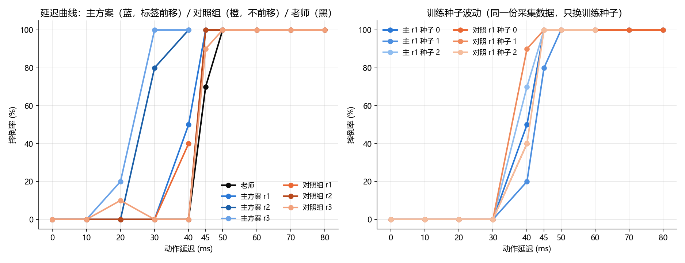

# T800 抗延迟实验报告

## 1. 实验目的

阶段 2 的学生策略在无扰动下已经能稳定行走，但它在动作延迟 30 ms 时就 100% 摔倒，
延迟容忍度只有约 20 ms，而老师（官方策略）的容忍度约 40 ms。本阶段要回答两个问题：

1. 把动作延迟加进采集和训练，能不能让学生扛住更大的延迟？
2. 能不能**超过**老师约 40 ms 的上限？

第二个问题才是本阶段的目标——只把学生补回 40 ms 没有意义，因为它本来就是为了超越老师才做的。

## 2. 实验条件

| 项目 | 设置 |
|---|---|
| 仿真环境 | MuJoCo 3.4，平地，地面摩擦系数 1.0 |
| 机器人 | T800 人形机器人，25 个关节，整机质量 84.9 kg |
| 老师 | 官方预训练模型 `t800_260318_150533_60000.mnn`，观测 1083 维、动作 22 维 |
| 学生 | MLP **1084** → 512 → 256 → 22（比阶段 2 多 1 维：延迟 d），ELU，MSE，Adam，学习率 1e-3，批大小 1024 |
| 训练环境 | CPU（PyTorch 2.15.0+cpu），无 GPU，每轮 30 epoch |
| 控制频率 | 策略 100 Hz，PD 500 Hz（仿真步长 0.002 s）；观测、PD、摔倒判断与 [25_t800_robustness.py](25_t800_robustness.py) 一致 |
| 训练延迟档位 | 0 / 10 / 20 / 30 / 40 / 50 / 60 ms（10 ms 的整数倍，见 3.1） |
| 评测延迟档位 | 0~80 ms 每 10 ms 一档，另**补测 45 ms**；70 / 80 ms 超出训练范围 |
| 评测重复次数 | 每档 10 个种子（0~9），每次 15 s |
| 摔倒判断 | 根部高度低于 0.6 m，或机身倾斜超过 45° |

老师的基准（阶段 2 用同样条件测得）：40 ms 以内 10 次全不摔，45 ms 摔 70%，50 ms 及以上 100%。

## 3. 方法

### 3.1 三条设计决定

| 决定 | 选法 | 理由 |
|---|---|---|
| 观测里的"上一帧动作" | 填**学生自己上一步的输出** | 部署时策略确实知道这个量；和老师的观测语义一致（老师也是"自己上一步的输出"） |
| 延迟 d 是否喂给网络 | **喂**，作为第 1084 维（d_ms / 60） | 让网络显式知道当前延迟，才有可能做预测性补偿 |
| 标签是否前移 | **前移（主方案）**，不前移作为对照组 | 主方案：t 时刻的目标 = 老师在 t+k 步观测上的动作（k = d/10），相当于提前把动作往前打，抵消执行滞后 |

两组**只差标签这一个设置**，其余（数据、网络、优化器、轮数、种子）完全相同，因此可以干净地对照。

### 3.2 采集：延迟执行 + 事后打标签（[30_t800_delay_student.py](30_t800_delay_student.py)）

1. 每个回合随机抽 d、vx（0.3~0.6）、初始关节角扰动（±0.10 rad）、途中推 0~3 次（40~120 N、0.2 s）；
2. 学生输出动作，放进长度 d+1 的目标角队列，PD 用队首（执行 d 之前发出的目标角）；
3. 每个推理步记录 72 维单帧 + 3 维指令 + 本回合的 d；摔倒就结束本回合；
4. **回合结束后**再打标签：对每一步 t，重建 t+k 步的 1083 维观测（15 帧历史 + 该步指令），
   送老师得到标签，**丢掉末尾 k 步**（没有 t+k 的观测）。

用事后批处理而不是实时标注，是因为老师是纯函数：只要轨迹和观测都记录下来了，任何时刻算 `a*(t+k)` 结果都一样。

每轮采集 60,000 步，共 3 轮；驱动策略第 1 轮用阶段 2 的学生（它不知道 d），之后用本轮新训的学生。

### 3.3 标签前移的正确性验证

对生成的 npz 抽 6 个回合 × 5 个时刻，分别用"老师在 t 步的动作"(A) 和"老师在 t+k 步的动作"(B) 与存储的标签比较：

| 比较对象 | 最大偏差 |
|---|---:|
| A（不前移） | 5.12（明显不一致） |
| B（前移 k 步） | **0.00e+00**（完全一致） |

说明标签确实是 t+k 步的老师动作，前移逻辑正确。

### 3.4 训练

整体流程与阶段 2 的 DAgger 相同：把本轮数据和已有数据（老师 30 万步 + DAgger 4 轮 + 本阶段各轮）拼接，
按回合划分训练 / 验证，只保存验证损失最好的权重。

**关于训练集里 d>0 的样本比例**：每轮都不足 1/3，因此采用**过采样**（重复带延迟的样本），
让 d>0 的占比补到约 1/3，d=0 的样本一条不丢。选过采样而不是加大采集量的理由：补齐到 1/3 需要再采约 27 万步
（约 10 分钟仿真 + 20 分钟打标签），过采样零成本；代价是重复样本降低了有效多样性。

| 轮次 | 训练集步数 | d>0 步数 | 占比 | 过采样倍数 | 过采样后 |
|---|---:|---:|---:|---:|---:|
| 主 r1 | 536,799 | 41,743 | 7.8% | ×6 | 33.6% |
| 主 r2 | 599,704 | 89,389 | 14.9% | ×3 | 34.4% |
| 主 r3 | 639,957 | 134,098 | 21.0% | ×2 | 34.6% |
| 对照 r1 | 537,101 | 42,045 | 7.8% | ×6 | 33.8% |
| 对照 r2 | 600,728 | 90,413 | 15.1% | ×3 | 34.7% |
| 对照 r3 | 647,527 | 137,803 | 21.3% | ×2 | 35.1% |

## 4. 结果

### 4.1 延迟曲线（每轮 10 个种子）

左图：主方案（蓝，标签前移）/ 对照组（橙，不前移）/ 老师（黑）；右图：训练种子波动（见 4.3）。
缺失的档位（例如对照组 r1 没有测 45 ms）在图中留空，没有插值填补。

**主方案（标签前移 d）**

| 延迟 | r1 | r2 | r3 |
|---:|---:|---:|---:|
| 0 ms | 0% | 0% | 0% |
| 10 ms | 0% | 0% | 0% |
| 20 ms | 0% | 0% | 20% |
| 30 ms | 0% | 80% | 100% |
| 40 ms | 50% | 100% | 100% |
| 50~80 ms | 100% | 100% | 100% |

**对照组（标签不前移）**

| 延迟 | r1 | r2 | r3 |
|---:|---:|---:|---:|
| 0 ms | 0% | 0% | 0% |
| 10 ms | 0% | 0% | 0% |
| 20 ms | 0% | 0% | 10% |
| 30 ms | 0% | 0% | 0% |
| 40 ms | 40% | 0% | 0% |
| 50~80 ms | 100% | 100% | 100% |

d=0 时的实际速度：主方案 r1/r2/r3 = 0.473 / 0.427 / 0.422 m/s，对照组 = 0.496 / 0.415 / 0.421 m/s
（指令 0.5 m/s，老师为 0.461 m/s）。

### 4.2 45 ms 补测（每档 10 个种子）

| 模型 | 45 ms 摔倒率 | 说明 |
|---|---:|---|
| 老师 | 70% | 阶段 2 用同样条件测得 |
| 对照 r2 | 100% | 追加到 `results/delay_latency.csv` |
| 对照 r3 | 90%（实际 vx 0.356） | 追加到 `results/delay_latency.csv` |
| 主方案 r1 | 100% | 追加到 `results/delay_latency_main.csv` |

45 ms 这一档**没有任何学生模型优于老师**。

### 4.3 训练种子波动（只训第 1 轮，采集数据不变）

同一份采集数据、同一套超参，只换训练随机种子（0/1/2）重训，再测 0~60 ms：

| 模型 | 30 ms | 40 ms | 45 ms | 50~60 ms |
|---|---:|---:|---:|---:|
| 主 r1，种子 0 | 0% | 50% | 100% | 100% |
| 主 r1，种子 1 | 0% | **20%** | 80% | 100% |
| 主 r1，种子 2 | 0% | **70%** | 100% | 100% |
| 对照 r1，种子 0 | 0% | 40% | 未测 | 100% |
| 对照 r1，种子 1 | 0% | **90%** | 100% | 100% |
| 对照 r1，种子 2 | 0% | 40% | 100% | 100% |

（数据：`results/delay_seed_variance.csv`。"未测"表示该组合没有测 45 ms，不做填补。）

读法：

- **30 ms 在 6 次训练中全部是 0%**，是稳定的通过点；
- **40 ms 在 20%~90% 之间大幅波动**（主方案 20/50/70，对照组 40/40/90），两组的分布完全重叠；
- **45 ms 是 80%~100%**，老师是 70%。

**因此：单次训练不足以比较方案优劣。** 表 4.1 里"主方案 50% vs 对照组 40%"这类差异，
以及主方案 r3（40 ms 100%）看起来更差的情况，都落在训练随机性范围内，不能作为结论。

### 4.4 d = 0 时的速度跟踪与抗推（单次训练，未做种子重复，差异不下结论）

| 模型 | 速度误差 0.3 / 0.4 / 0.5 / 0.6 (m/s) | 抗推 前 / 后 / 左 / 右 (N) | 四档速度摔倒率 |
|---|---|---|---:|
| 老师 | 0.031 / 0.054 / 0.039 / 0.069 | 450 / 500 / 300 / 150 | 全 0% |
| 阶段 2 学生 | 0.004 / 0.023 / 0.037 / 0.091 | 350 / 350 / 200 / 175 | 全 0% |
| 对照 r2 | 0.028 / 0.055 / 0.085 / 0.109 | 400 / 375 / 250 / 275 | 全 0% |
| 主方案 r1 | 0.036 / 0.008 / 0.027 / 0.087 | 300 / 300 / 225 / 125 | 全 0% |

说明：

- 这一栏用的是两个中间轮次的权重（对照 r2、主方案 r1），和 4.1 里各轮的最终权重不是同一个模型；
- 每个模型只训了**一次**、每个条件 10 个种子，**没有做训练种子的重复**，所以表里的差异
  （例如抗推 400 vs 300 N、速度误差 0.008 vs 0.036）**只能记录，不能下结论**；
- 可以确定的是：**所有阶段 3 模型在 d = 0 的四档速度下摔倒率都是 0%**，即没有为了抗延迟而失去基本行走能力；
- 数据：`results/delay_speed_extra.csv`、`results/delay_push_extra.csv`。

## 5. 不足

1. **回合末尾丢掉的 k 步，正是摔倒前最关键的一段数据**。标签前移要求 t+k 的观测存在，
   所以每个回合最后 k 步（k = 2~6 步，20~60 ms）被丢弃；而学生恰恰常在摔倒前那几百毫秒出事，
   这段"崩溃过程"的样本因此系统性缺失。可以通过"回合结束后继续空跑 k 步再截断"补回来，本阶段没有做。
2. **每轮只采 6 万步、只做 3 轮**，d>0 的样本始终不足 1/3，靠过采样（重复 2~6 次）补到 33%~35%，
   重复样本降低了有效多样性。
3. **单次训练的波动远大于方案差异**（4.3 节：40 ms 在 20%~90% 之间变化），
   而主方案与对照组各只做了 3 轮、每轮 1 次训练，因此两者的比较不足以支持结论。
4. **40 ms 这个点本身不稳定**，而它是判断"有没有超过老师"的关键点；需要更多种子 × 更多训练重复才能定论。
5. **45 ms 只补测了 3 个模型**，对照 r1（种子 0）等组合没有测（表中记为"未测"）。
6. **评测每档只有 10 个种子**，临界档位的统计误差约 ±1 个种子（10 个百分点）。
7. **训练延迟只取 10 ms 的整数倍**（标签只能在策略步边界上前移），而执行延迟的粒度是 2 ms，
   所以 45 ms 这一档实际执行的是 44 ms，与训练档位不完全对齐。
8. 图只画了摔倒率，没有画各档的实际速度（速度数据在 `results/delay_latency*.csv` 里）。

## 6. 结论

1. **30 ms 是稳定通过点**：6 次训练（主方案 3 个种子 + 对照组 3 个种子）在 30 ms 下全部是 0% 摔倒。
   作为对照，阶段 2 的学生在 30 ms 就 100% 摔倒。
2. **40 ms 不稳定**：6 次训练的结果在 20%~90% 之间（主 20/50/70，对照 40/40/90），
   两组分布完全重叠，**单次训练不足以比较方案优劣**。
3. **45 ms 全部不优于老师**：学生 80%~100%，老师 70%。
4. **没有超过老师的延迟上限**：老师 40 ms 全不摔、45 ms 才 70%；学生最好也只做到"40 ms 有时不摔"。
   45 ms 上学生 80%~100%、老师 70%，差距在单档统计误差附近（每档 10 个种子，差 1 个种子就是 10 个百分点），
   **没有看出优于老师**。阶段 3 的目标（超过约 40 ms）**未达成**。
5. **在单次训练下，标签前移没有带来额外收益**（40 ms 均值 47% vs 57%，差异在种子波动范围内）；
   **是否有害还需种子重复确认**。
6. **d = 0 时的基本能力没有丢失**：所有阶段 3 模型在四档速度指令下摔倒率都是 0%；
   速度和抗推的差异属于单次训练的波动，不做结论（4.4 节）。

## 7. 可能的原因（待验证）

- **阶段 3 学生比阶段 2 学生延迟容忍度更高，可能来自延迟状态下的 DAgger 采集、d 输入、过采样、
  更多数据中的一项或几项**，本实验没有隔离这些因素，属于**未验证的推测**。
- **标签前移为什么没有收益**：前移后的标签要"预测未来 k 步的动作"，任务更难，在同样 30 epoch 下拟合不足，
  而且学生会把"预测"和"观测"耦合在一起。属于**未验证的推测**。
- **40 ms 为什么波动这么大**：40 ms 相当于落后 4 个策略步，而观测历史只有 15 帧（150 ms），
  用于区分 30/40/60 ms 的信息可能刚好处于临界；不同训练种子学到的是不同的补偿强度。属于**未验证的推测**。
- **过采样的副作用**：带延迟样本被重复 2~6 次，模型可能对"学生自己旧状态"过拟合，
  轮次越靠后 d>0 的重复次数越少、但旧数据越多，两者方向相反。属于**未验证的推测**。
- **老师为什么在延迟下走得更快（0.461 → 0.600 m/s）**：可能是它在补偿执行滞后，学生没有学到这种补偿。
  属于**未验证的推测**（延迟与噪声实验报告也提出了同一点）。

## 8. 本实验的局限

- 只在平地、默认摩擦、无负载、0.5 m/s 直线行走的条件下评测，没有测延迟与推力、摩擦、负载的组合。
- 延迟是固定值，没有测试抖动（时变延迟）；真机上的延迟会波动。
- 网络固定为 MLP 1084 → 512 → 256 → 22，没有尝试更大容量（例如直接吃 15 帧 × 72 的时序结构）。
- 只在仿真中验证，没有真机实验。

