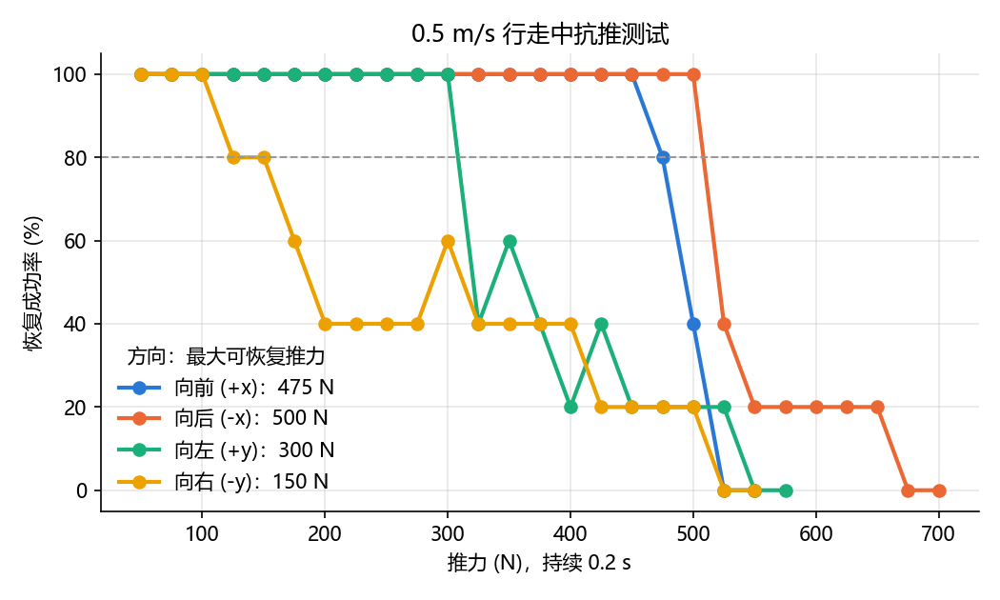
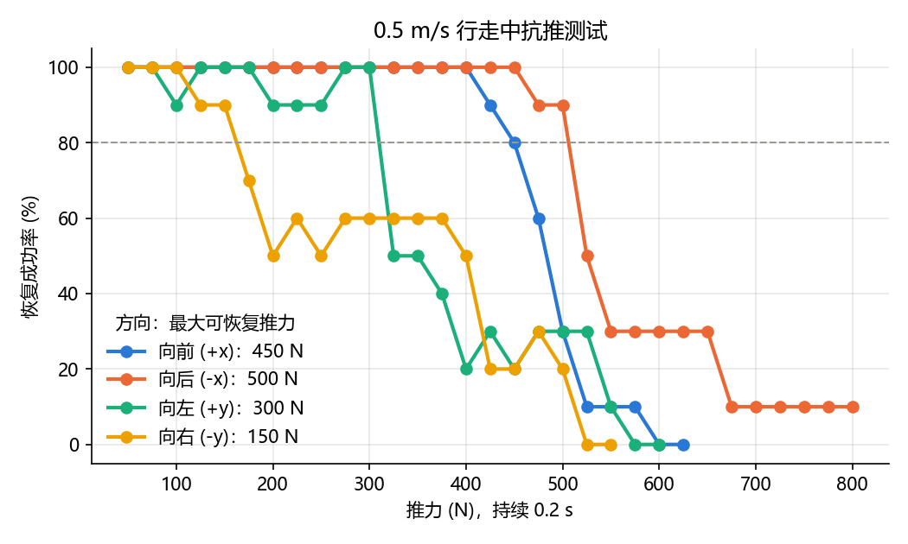
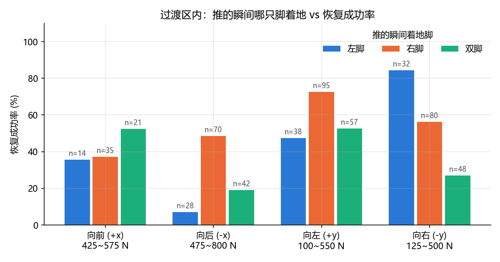
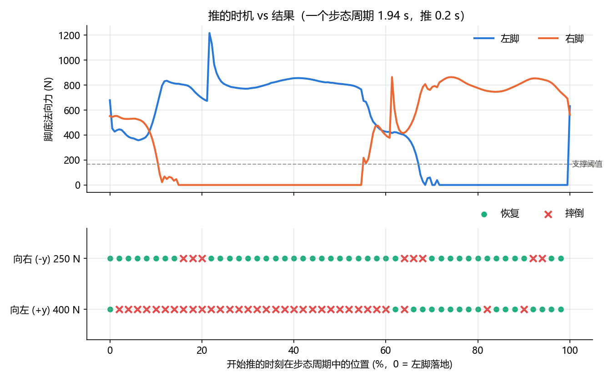
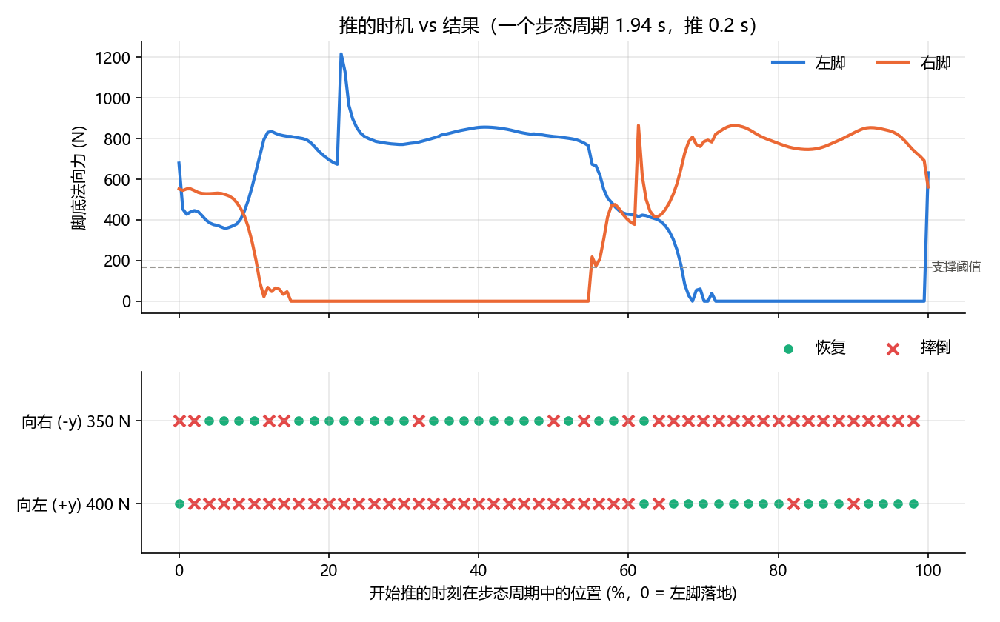

# T800 行走策略抗推实验报告

## 1. 实验目的

测试官方预训练的 RL 行走策略在行走中被外力推一下时能不能恢复：每个方向最大能扛多大的力，以及恢复能力和推的时机有什么关系。

## 2. 实验条件

以下条件在所有版本中保持不变。

| 项目 | 设置 |
|---|---|
| 仿真环境 | MuJoCo 3.4，平地，地面摩擦系数 1.0 |
| 机器人 | T800 人形机器人，25 个关节，整机质量 84.9 kg |
| 策略 | 官方预训练模型 `t800_260318_150533_60000.mnn`，策略推理 100 Hz，PD 控制 500 Hz |
| 控制参数 | 默认站姿、PD 增益、动作缩放、力矩限幅均与官方 SDK 部署配置一致 |
| 行走指令 | vx = 0.5 m/s，vy = 0，开启航向闭环，机器人始终朝 +x 方向走 |
| 推力 | 水平力，作用在机身（LINK_BASE）上，持续 0.2 s |
| 推的方向 | 向前 (+x)、向后 (−x)、向左 (+y)、向右 (−y)，世界坐标系 |
| 仿真时长 | 每次 15 s，推完后机器人还要继续走约 9 s，没摔才算恢复 |
| 初始扰动 | 初始关节角加 ±0.02 rad 随机扰动，由随机种子决定 |
| 摔倒判断 | 根部高度低于 0.6 m，或机身倾斜超过 45° |
| 最大可恢复推力 | 推力从小到大，成功率第一次低于 80% 之前的那一档 |

作为对照：站立时只用踝策略平衡（[12_2_t800_pd_balance.py](12_2_t800_pd_balance.py)），能扛住 100 N × 0.2 s，200 N 就会摔倒。

评测脚本：[25_t800_robustness.py](25_t800_robustness.py)。第一、二版运行 `python 25_t800_robustness.py push`，第三版运行 `python 25_t800_robustness.py phase`。

## 3. 第一版：每档推力 5 次

### 3.1 方法

- 推力从 50 N 开始，每档加 25 N，最大 800 N。连续 2 档全部摔倒就停止。
- 每档推力跑 5 次（种子 0~4）。推的时刻在 5~6 s 之间随机选，让推的时机覆盖步态的不同阶段。

### 3.2 结果

| 方向 | 最大可恢复推力 |
|---|---:|
| 向前 | 475 N |
| 向后 | 500 N |
| 向左 | 300 N |
| 向右 | 150 N |

前后方向的曲线是一个明显的台阶：推力不到上限时 5 次全部恢复，超过上限后成功率很快降到 0。侧向的曲线不是台阶：向右推从 125 N 就开始有失败，但 200~400 N 之间成功率一直停在 40% 左右，没有继续下降；向左推在 325~525 N 之间，成功率在 20%~60% 之间来回跳。

### 3.3 第一版的不足

1. **每档只有 5 次**：成功率只能是 0、20%、40% 这样按 20% 一档变化，太粗。
2. **没有记录推的时机**：侧向成功率不随推力单调下降，说明结果可能和推的时机有关，但没有数据去验证。
3. **CSV 中的数字没有四舍五入**：出现了 `0.19999999999999996` 这样的值。

## 4. 第二版：每档推力 10 次，记录着地脚

### 4.1 调整方案

- 每档推力从 5 次增加到 10 次（种子 0~9）。
- 每次推的时候，记录推的时刻，以及推的那一瞬间哪只脚在支撑。一只脚的法向力超过整机重量的 20%（约 167 N）才算这只脚在支撑。一开始用的是固定 50 N 阈值，抽查发现会把只是脚尖蹭地的情况误判为双脚支撑，所以改成按体重比例计算。
- 成功率保留 3 位小数。
- 增加按着地脚分组的统计，只统计过渡区内的数据。过渡区是指从第一次出现摔倒的推力，到最后一次还有恢复的推力之间的范围，在这个范围内，同样的推力有时摔、有时不摔。

一共 990 次仿真，用时约 23 分钟。

### 4.2 结果

| 方向 | 第一版（5 次） | 第二版（10 次） |
|---|---:|---:|
| 向前 | 475 N | 450 N |
| 向后 | 500 N | 500 N |
| 向左 | 300 N | 300 N |
| 向右 | 150 N | 150 N |

重复次数加倍后，只有向前从 475 N 变成了 450 N，其余三个方向不变，说明第一版的数字基本可信。

| 方向 | 过渡区 | 左脚支撑时 | 右脚支撑时 | 双脚支撑时 |
|---|---|---:|---:|---:|
| 向前 | 425~575 N | 36% | 37% | 52% |
| 向后 | 475~800 N | 7% | 49% | 19% |
| 向左 | 100~550 N | 47% | 73% | 53% |
| 向右 | 125~500 N | 84% | 56% | 27% |

侧向似乎存在规律：向左推时右脚支撑更容易恢复，向右推时左脚支撑更容易恢复。

### 4.3 第二版的不足

**着地脚分组的有效样本只有 10 个。** 推的时刻只由随机种子决定，而种子只有 0~9 这 10 个。所以不管推力是 100 N 还是 500 N，同一个种子推的时刻都相同，着地脚也相同。表中各组的次数（比如 95 次）只是把同样 10 个时刻在不同推力下重复数了很多遍。上面那个规律可能只是两三个时刻碰巧造成的，需要专门的实验来验证。

另外，第二版还发现两个没有解释的现象：

- 向后推一直推到 800 N，成功率还剩 10%：有 1 个时刻推多大都不倒。
- 向左推 100 N 时出现了 1 次摔倒，但 125~300 N 反而全部恢复。

## 5. 第三版：在一个步态周期内均匀取时刻推

### 5.1 方法

- 推力固定在侧向过渡区内，只改变推的时刻。
- 初始状态固定为种子 0，所以推之前的步态每次都完全一样，推的时刻就直接对应步态中的位置（步态相位）。
- 先不推跑一次，记录左右脚受力，找出步态周期：1.94 s，每迈一步约 0.97 s。
- 从 5 s 之后左脚第一次落地开始，在一个周期内均匀取 50 个时刻，每个时刻推一次。

按支撑阈值，一个步态周期大致分为四段（0% = 左脚落地）：

| 相位 | 支撑状态 |
|---|---|
| 0~10% | 双脚支撑 |
| 10~55% | 左脚支撑，右脚抬起往前迈 |
| 55~68% | 双脚支撑 |
| 68~100% | 右脚支撑，左脚抬起往前迈 |

### 5.2 第一次：向左 400 N，向右 250 N

| 推的时候哪只脚在支撑 | 向左推 400 N | 向右推 250 N |
|---|---:|---:|
| 左脚 | 0%（22 个时刻） | 86%（22 个时刻） |
| 双脚 | 25%（12 个时刻） | 83%（12 个时刻） |
| 右脚 | 88%（16 个时刻） | 81%（16 个时刻） |
| 总成功率 | 34% | 84% |

向左推时规律非常明显。向右推时三种情况的成功率差不多，8 次摔倒集中在换脚的瞬间（16~20%、64~68%、92~94%）。

但两个方向的难度不一样：向左总成功率 34%，向右 84%，向右推得太轻，大部分时刻都扛得住，掩盖了着地脚的影响。所以把向右推力加到 350 N 再测一次。

### 5.3 第二次：向左 400 N，向右 350 N

| 推的时候哪只脚在支撑 | 向左推 400 N | 向右推 350 N |
|---|---:|---:|
| 左脚 | **0%**（22 个时刻） | 77%（22 个时刻） |
| 双脚 | 25%（12 个时刻） | 58%（12 个时刻） |
| 右脚 | 88%（16 个时刻） | **0%**（16 个时刻） |
| 总成功率 | 34% | 48% |

两个方向的规律完全对称：被推向支撑腿那一侧时一次都没恢复，被推向摆动腿那一侧时大部分都能恢复。

数据：[results/push_phase.csv](results/push_phase.csv)，[results/push_phase_250N.csv](results/push_phase_250N.csv)。

## 6. 结论

1. **最大可恢复推力**（0.5 m/s 行走，推 0.2 s，成功率 ≥ 80%）：向前 450 N，向后 500 N，向左 300 N，向右 150 N。前后方向比侧向能扛得多，大约是侧向的 1.5~3 倍。
2. **行走中比站立时更抗推**：站立时只用踝策略，100 N 就到极限；行走中的 RL 策略即使在最弱的向右方向也能扛 150 N，前后方向能扛到约 500 N。原因是行走策略可以通过迈步来调整支撑位置，踝策略做不到这一点。
3. **侧向恢复能力取决于推的时机**：被推向支撑腿那一侧时恢复率为 0%，被推向摆动腿那一侧时为 77%~88%，左右对称。说明策略主要依靠"摆动腿向受力方向迈一步"来恢复平衡。被推向支撑腿一侧时，摆动腿要交叉迈到支撑腿另一侧才行，这一步迈不出来，所以会摔。
4. **"最大可恢复推力"一个数字不足以描述侧向抗推能力**：侧向的成功率曲线有很长的拖尾，比如向右推 200~400 N 时成功率一直在 50%~60% 左右。这不是因为力的大小，而是因为大约一半的时刻恰好是"有利"的时机。时机不对时 150 N 就可能摔，时机对了 400 N 也能扛住。

### 可能的原因（待验证）

- **向右推上限只有 150 N，比向左推的 300 N 低一半**：原因还不清楚。第三版中向右推 250 N 时，摔倒集中在换脚的瞬间，说明向右推在换脚时特别脆弱，但为什么向左推没有这个问题，还需要用窗口回放去看。另外，这个步态本身左右不均衡：一个周期中左脚支撑约占 45%，右脚支撑约占 32%。这种不对称可能和速度实验中"向左走只能达到指令的一半"有关系。
- **前后方向不受时机影响**：第二版中前后方向的着地脚分组没有明显规律，可能因为前后方向本来就是行走的方向，策略在任何时刻都能通过调整步长来应对。

### 本实验的局限

- 只在平地、0.5 m/s 直线行走的条件下测试。
- 推力持续时间只测了 0.2 s 一种，作用点只有机身一处。
- 第三版只用了一种初始状态（种子 0）和一个步态周期，0% 和 77%~88% 这几个具体数字换条件后可能会变，但左右对称的规律应该比较稳定。
- 第二版中向后推 800 N 还能恢复的那 1 个时刻，和向左推 100 N 摔倒的那 1 次，都还没有用窗口回放分析原因。
- 只在仿真中测试，没有在真机上验证。
