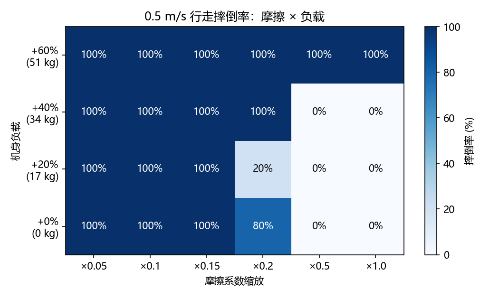
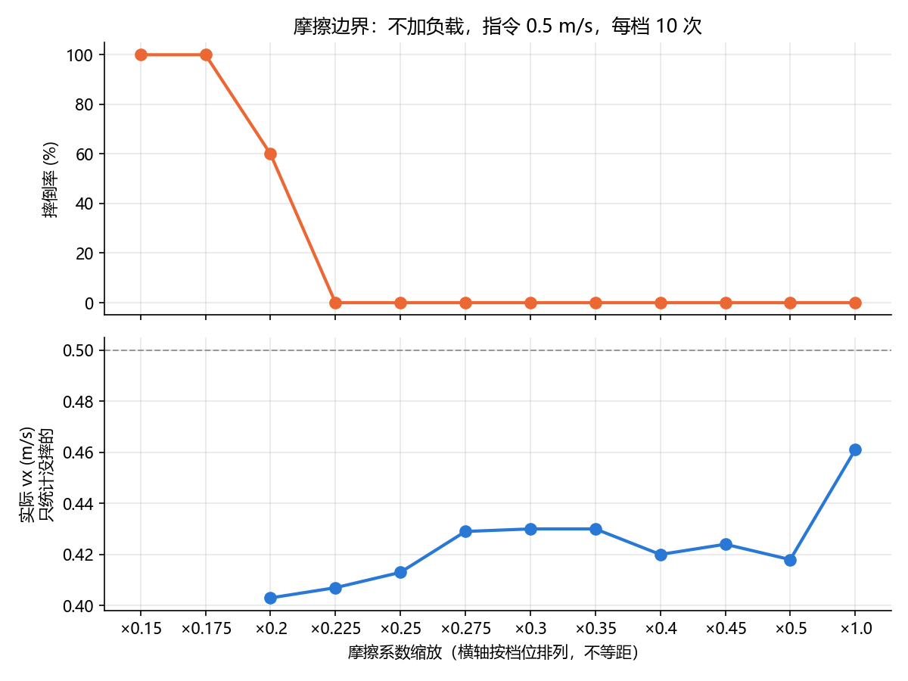
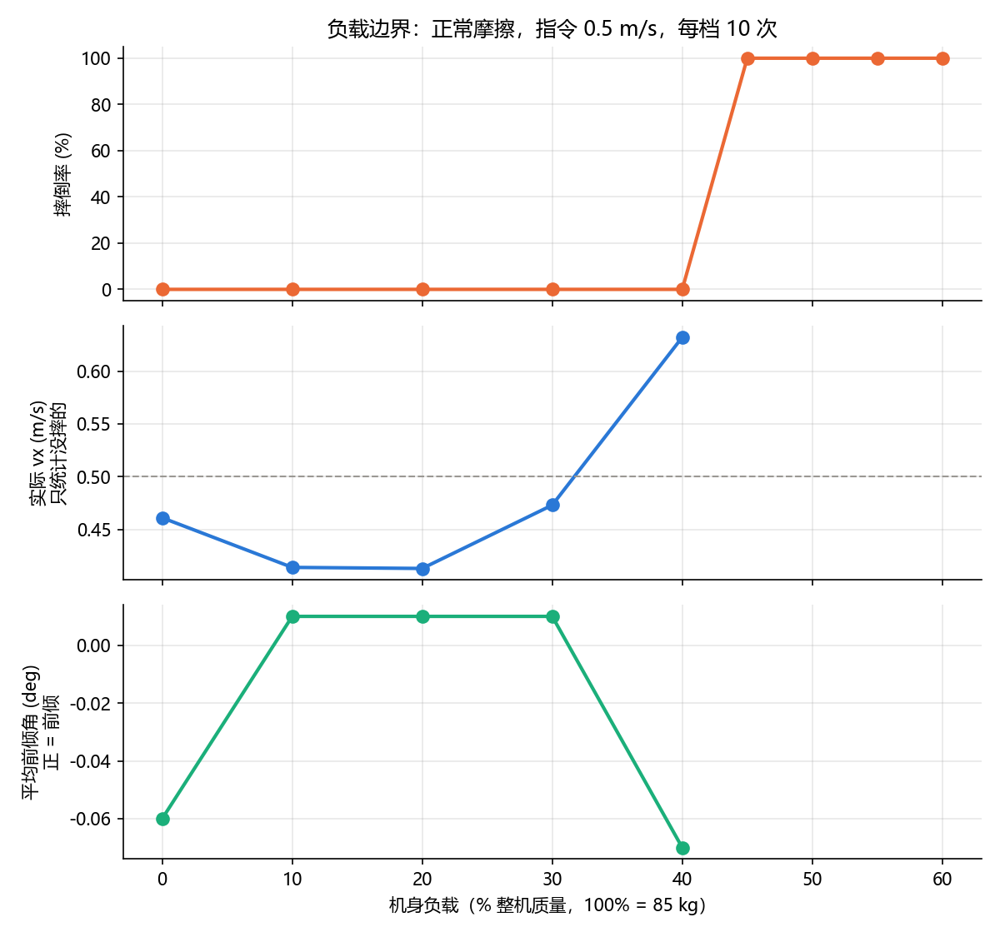
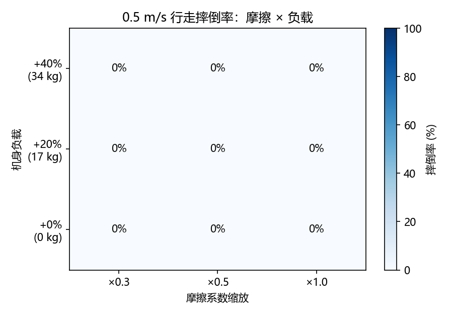
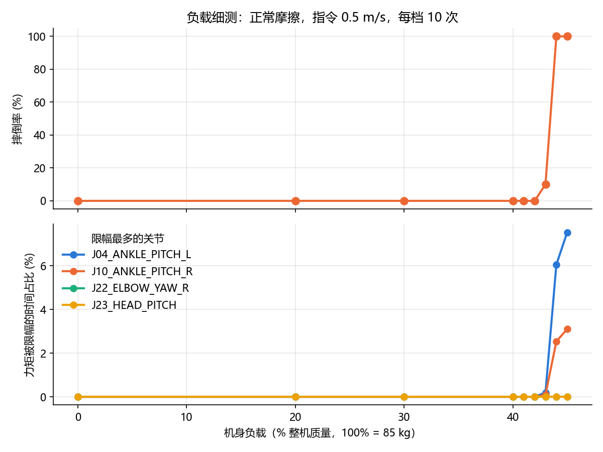
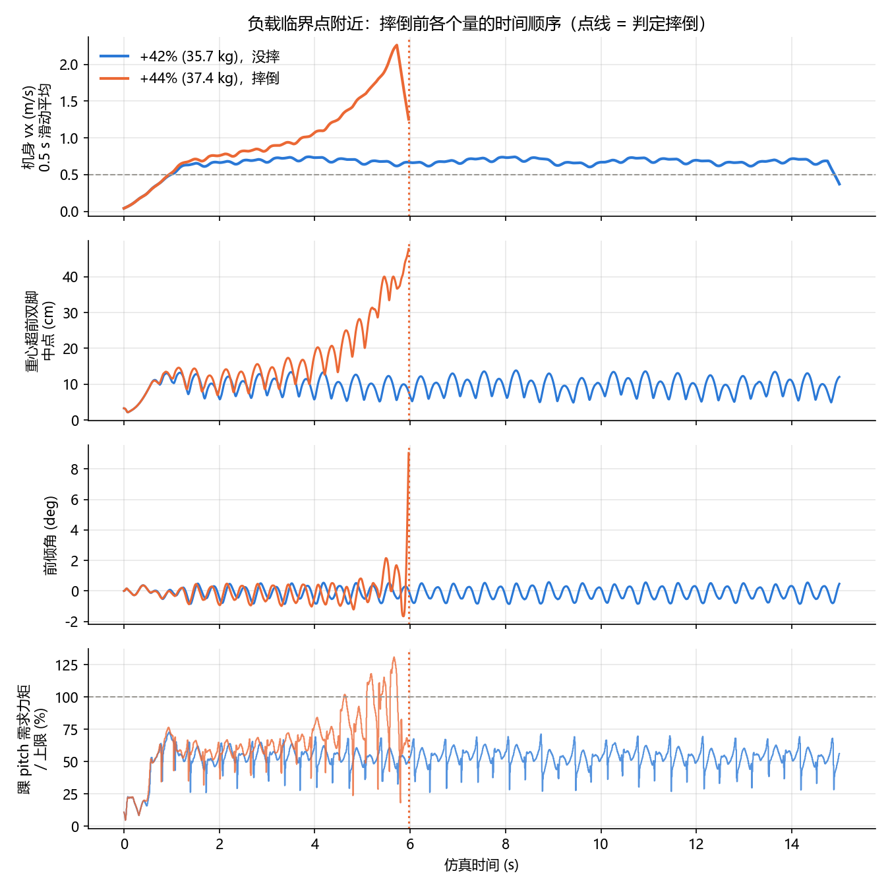

# T800 行走策略摩擦与负载实验报告

## 1. 实验目的

测试官方预训练的 RL 行走策略在动力学参数和仿真默认值不一致时还能不能走：地面变滑到什么程度会摔，身上背多重会摔，以及摔倒的原因是什么。这两类偏差对应真机上的不同地面（瓷砖、湿地面）和背负载荷。

## 2. 实验条件

以下条件在所有版本中保持不变。

| 项目 | 设置 |
|---|---|
| 仿真环境 | MuJoCo 3.4，平地 |
| 机器人 | T800 人形机器人，25 个关节，整机质量 84.9 kg |
| 策略 | 官方预训练模型 `t800_260318_150533_60000.mnn`，策略推理 100 Hz，PD 控制 500 Hz |
| 控制参数 | 默认站姿、PD 增益、动作缩放、力矩限幅均与官方 SDK 部署配置一致，力矩上限为额定值的 80%~90% |
| 行走指令 | vx = 0.5 m/s，vy = 0，开启航向闭环 |
| 仿真时长 | 每次 15 s，前 3 s 为起步阶段，不计入速度统计 |
| 初始扰动 | 初始关节角加 ±0.02 rad 随机扰动，由随机种子决定 |
| 摔倒判断 | 根部高度低于 0.6 m，或机身倾斜超过 45° |
| 外部干扰 | 无（不推、不加延迟和噪声） |

两个变量的含义：

- **摩擦缩放**：地面和机器人所有接触面的摩擦系数，都乘以这个倍数。1.0 是默认值，越小越滑。MuJoCo 中两个物体接触时取两者摩擦系数的较大值，所以只改地面不起作用，必须一起缩放。
- **负载**：加在机身（LINK_BASE）上的质量，用整机质量的百分比表示，比如 20% ≈ 17 kg。机身的转动惯量按同样比例放大，相当于机身整体变重。

评测脚本：[25_t800_robustness.py](25_t800_robustness.py)。第二版运行 `python 25_t800_robustness.py dynamics`，细测运行 `payload`，时间线分析运行 `trace`。

## 3. 第一版：摩擦 × 负载组合，每组 5 次

### 3.1 方法

摩擦 6 档（0.05、0.1、0.15、0.2、0.5、1.0）× 负载 4 档（0、20%、40%、60%），两两组合共 24 种条件，每种跑 5 次，共 120 次仿真。

### 3.2 结果

**摔倒率**

| 负载 ＼ 摩擦 | ×0.05 | ×0.1 | ×0.15 | ×0.2 | ×0.5 | ×1.0 |
|---|---:|---:|---:|---:|---:|---:|
| 0 | 100% | 100% | 100% | 80% | 0% | 0% |
| +20%（17 kg） | 100% | 100% | 100% | 20% | 0% | 0% |
| +40%（34 kg） | 100% | 100% | 100% | 100% | 0% | 0% |
| +60%（51 kg） | 100% | 100% | 100% | 100% | 100% | 100% |

**实际 vx（m/s，只统计没摔的）**

| 负载 ＼ 摩擦 | ×0.5 | ×1.0 |
|---|---:|---:|
| 0 | 0.421 | 0.466 |
| +20% | 0.408 | 0.413 |
| +40% | 0.594 | 0.632 |

大致结论：摩擦要高于 0.2~0.5 倍，负载要低于 40%~60%，否则会摔。

### 3.3 第一版的不足

1. **两条边界中间都没有测试点**：摩擦的边界在 0.2~0.5 之间，负载的边界在 40%~60% 之间，但这两段都没有测试点。
2. **测试点浪费**：摩擦 0.05、0.1、0.15 三档全部 100% 摔倒，结果重复。
3. **摩擦 0.2 那一列结果不合常理**：不加负载时摔 80%，加 17 kg 反而只摔 20%。原因是 0.2 正好在临界点上，结果对随机性很敏感，5 次重复太少。
4. **加 40% 负载后反而走得更快（0.632 m/s）**，原因不明。

## 4. 第二版：拆开测、加密测，每组 10 次

### 4.1 调整方案

- **把两个变量拆开测**：每次只改一个变量，分别找出摩擦和负载的边界。
- **测试点集中在边界附近**：
  - 摩擦（不加负载）：0.15~0.3 之间每 0.025 一档，0.3~0.5 之间每 0.05 一档，再加 1.0 作对照，共 12 档。第一版中 0.2 倍已经摔了 80%，边界很可能靠近 0.2，所以这一段测得更密。
  - 负载（正常摩擦）：0~40% 每 10% 一档，40%~60% 每 5% 一档，共 9 档。
- **保留一个小的组合测试**：摩擦 0.3、0.5、1.0 × 负载 0、20%、40%，共 3 × 3。
- **每组重复 10 次**。
- **新增一列"平均前倾角"**：第 3 s 以后机身 pitch 的平均值，用来检验"背重物后身体前倾，所以走得快"这个猜想。

一共 300 次仿真，用时约 6 分钟。

### 4.2 摩擦边界

| 摩擦缩放 | 0.15 | 0.175 | 0.2 | 0.225 | 0.25 | 0.275 | 0.3~0.5 | 1.0 |
|---|---:|---:|---:|---:|---:|---:|---:|---:|
| 摔倒率 | 100% | 100% | 60% | 0% | 0% | 0% | 0% | 0% |
| 实际 vx | — | — | 0.403 | 0.407 | 0.413 | 0.429 | 0.418~0.430 | 0.461 |

边界在 0.2~0.225 之间，是一条有过渡的边界：0.2 时 10 次里摔 6 次。0.3~0.5 那一段全是 0%，和预测的一样。摩擦只要低于正常值，实际速度就从 0.46 m/s 降到 0.40~0.43 m/s。

### 4.3 负载边界

| 负载 | 0% | 10% | 20% | 30% | 40% | 45% | 50% | 55% | 60% |
|---|---:|---:|---:|---:|---:|---:|---:|---:|---:|
| 负载 (kg) | 0 | 8.5 | 17.0 | 25.5 | 34.0 | 38.2 | 42.5 | 46.7 | 51.0 |
| 摔倒率 | 0% | 0% | 0% | 0% | 0% | 100% | 100% | 100% | 100% |
| 实际 vx | 0.461 | 0.414 | 0.413 | 0.473 | 0.632 | — | — | — | — |
| 平均前倾角 (°) | −0.06 | +0.01 | +0.01 | +0.01 | −0.07 | — | — | — | — |

- **边界在 40%~45% 之间，是悬崖式的**：40% 时 10 次全不摔，45% 时 10 次全摔，中间没有过渡。
- **速度先降后升**：加 10% 负载后速度从 0.461 降到 0.414，之后负载越大走得越快，40% 时达到 0.632，超出指令 26%。
- **前倾猜想被否定**：所有条件下平均前倾角都在 ±0.1° 以内。40% 负载时速度最快，前倾角却是 −0.07°。所以"背重物后身体前倾，所以走得快"这个解释不成立。

### 4.4 组合测试

| 负载 ＼ 摩擦 | ×0.3 | ×0.5 | ×1.0 |
|---|---:|---:|---:|
| 0 | 0%（0.430） | 0%（0.418） | 0%（0.461） |
| +20% | 0%（0.404） | 0%（0.408） | 0%（0.413） |
| +40% | 0%（0.545） | 0%（0.593） | 0%（0.632） |

括号内是实际 vx（m/s）。9 种组合全部 0% 摔倒，因为选的条件都在两条边界以内。负载 40% 时，地面越滑，速度越慢。

### 4.5 第二版的不足

1. **负载边界还不够精确**：40% 和 45% 之间是悬崖式跳变，具体在哪里失效还不知道。
2. **不知道负载太重时为什么会摔**：最初的猜想是关节电机力矩不够，但没有记录力矩数据，无法验证。
3. **重复次数只在临界点附近有用**：不会摔的条件下，10 次结果几乎完全一样。比如 40% 负载时 10 次都是 0.632 m/s。原因是初始扰动只有 ±0.02 rad，起步几秒后步态就收敛到同一个状态。

## 5. 第三版：负载细测 + 关节力矩限幅统计

### 5.1 方法

- 负载 40%~45% 之间每 1% 一档，前面加 0、20%、30%、40% 作对照，共 9 档，每档 10 次。
- 统计每个关节"力矩被限幅的时间占比"：PD 算出的需求力矩达到上限的仿真步数 ÷ 总仿真步数。摔倒的那次只统计到摔倒为止。
- 记录摔倒的平均时刻。

一共 90 次仿真，用时 161 s。

### 5.2 结果

| 负载 | 40% | 41% | 42% | 43% | 44% | 45% |
|---|---:|---:|---:|---:|---:|---:|
| 负载 (kg) | 34.0 | 34.8 | 35.7 | 36.5 | 37.4 | 38.2 |
| 摔倒率 | 0% | 0% | 0% | 10% | 100% | 100% |
| 实际 vx (m/s) | 0.632 | 0.654 | 0.686 | 0.738 | — | — |
| 平均摔倒时刻 (s) | — | — | — | 12.8 | 6.1 | 4.9 |
| 左踝 pitch 限幅占比 | 0% | 0% | 0% | 0.2% | 6.1% | 7.5% |
| 右踝 pitch 限幅占比 | 0% | 0% | 0% | 0.1% | 2.5% | 3.1% |

- **负载边界在 42%~44% 之间，约 36~37 kg**：从"基本不摔"到"一定摔"只差 2% 的负载，大约 1.7 kg。
- **"膝关节力矩不够"的猜想不成立**：所有负载下膝关节都没有达到力矩上限。唯一出现限幅的是左右踝关节的 pitch（前后摆动方向）。40%~42% 时所有关节都没有限幅，说明快摔之前电机力矩是够用的。
- **越接近边界，速度涨得越快**：40%~43% 之间，实际速度从 0.632 涨到 0.738 m/s，每多 1% 负载，涨幅都比上一档大。
- 图中下半部分的手肘（ELBOW_YAW_R）和头部（HEAD_PITCH）两条线始终为 0。画图时固定取限幅最多的 4 个关节，但实际只有两个踝关节出现过限幅，这两条线可以忽略。

### 5.3 第三版的不足

踝关节限幅只在快摔的时候才出现，无法区分它是摔倒的**原因**（踝关节力矩不够，所以摔了），还是**结果**（机器人已经失去平衡，踝关节拼命往回拉才达到上限）。要区分，需要看时间顺序。

## 6. 第四版：临界点两侧的时间线对比

### 6.1 方法

对比负载 42%（刚好不摔）和 44%（一定摔）各一次仿真（种子 0），每个仿真步记录：

- 机身前进速度 vx（画图时用 0.5 s 滑动平均，单步速度在步态里起伏很大）
- 重心超前双脚中点的水平距离
- 机身前倾角
- 左右踝 pitch 的需求力矩 ÷ 力矩上限（≥ 100% 表示被限幅）

然后找出 44% 那次中各个量第一次出现异常的时刻，看谁先出问题。异常的标准以 42% 那次作为参照：

| 事件 | 判断标准 |
|---|---|
| 速度失控 | 0.5 s 平均速度持续超出 42% 组平均速度的 20% |
| 重心跑偏 | 重心偏移超出 42% 组正常波动范围的 1.5 倍 |
| 踝关节限幅 | 任一踝 pitch 需求力矩 ≥ 上限 |
| 身体前倾 | 前倾角 > 10° |

### 6.2 结果

44% 负载时，各个量出问题的顺序：

| 顺序 | 事件 | 时刻 |
|---|---|---|
| 1 | 速度开始比 42% 组快 | 约 1.5~2 s |
| 2 | 重心越来越超前双脚 | 3.4 s |
| 3 | 踝关节第一次限幅 | 4.6 s |
| 4 | 判定摔倒 | 6.0 s |
| — | 前倾超过 10° | 直到摔倒都没有出现 |

说明：

- "速度失控"的时刻需要看图判断。程序记录的是 3.00 s，但那只是检测开始的时间（前 3 s 是起步阶段，不检测）。从图上看，两条速度曲线在 1.5~2 s 就已经分开了。
- 42% 那条速度曲线在 15 s 处突然下降，这是滑动平均在数据末尾的计算误差，不是真实现象。

**42% 负载时**：速度稳定在约 0.68 m/s，重心在 5~13 cm 之间规律地来回摆动，踝关节力矩最高用到上限的 50%~75%，15 s 内一直稳定。

**44% 负载时**：速度从约 0.7 m/s 一路涨到 2.2 m/s，重心超前双脚的距离从正常的 5~13 cm 增加到 45 cm。踝关节在 4.6 s 才第一次限幅，比速度失控晚了约 3 s。前倾角直到摔倒前 0.5 s 都在 ±2° 以内。

### 6.3 摔倒的过程

1. 身体太重，起步后重心比正常情况更靠前。
2. 机器人加快步子去追重心，速度越来越快。
3. 越追越快，重心反而离双脚越来越远，形成恶性循环。
4. 最后踝关节力矩打满，也拉不回来了，摔倒。

整个过程中机器人身体保持直立，是被重心带着越冲越快，而不是身体往前栽。这也解释了为什么第二版中平均前倾角一直接近 0。

## 7. 结论

1. **摩擦边界在 0.2~0.225 倍之间**：摩擦缩放到默认值的 0.225 倍以上，10 次都没摔；0.2 倍时摔倒率 60%；0.175 倍及以下全部摔倒。这条边界有过渡区，在临界点附近结果受随机性影响。
2. **负载边界在 42%~44% 之间，约 36~37 kg**：这条边界是悬崖式的，负载每多 1%，摔倒率从 0% 跳到 10%，再跳到 100%。
3. **负载失效的原因是策略的平衡能力不足，不是电机力矩不够**：
   - 膝关节从未限幅；踝关节在快摔前才出现限幅。
   - 时间线对比显示，速度失控比踝关节力矩饱和早约 3 s。踝关节限幅是摔倒过程中的结果，不是原因。
4. **接近负载边界时，机器人会越走越快**：负载 40%~43% 时实际速度为 0.63~0.74 m/s，超出 0.5 m/s 的指令 26%~48%。这是失效的前兆，可以作为预警信号。
5. **"背重物后身体前倾，所以走得快"的猜想被否定**：所有条件下平均前倾角都在 ±0.1° 以内，失效过程中前倾角也一直在 ±2° 以内。
6. **地面变滑会让速度变慢**：摩擦低于正常值时，实际速度从 0.46 m/s 降到 0.40~0.43 m/s。负载 40% 时也是一样，摩擦越低速度越慢。

### 可能的原因（待验证）

- **负载边界**：训练时机身质量的随机化范围可能没有覆盖到这么重的情况，超出范围后，策略不会通过调整步伐来控制速度。官方训练配置拿不到，无法直接验证。
- **摩擦边界**：摩擦太低时脚底打滑，策略的动作无法产生预期的效果。可以统计脚底的滑动速度来验证。
- **加 10% 负载时速度先下降**：负载从 0 加到 10%，速度从 0.461 降到 0.414，原因还不清楚。

### 本实验的局限

- 负载只加在机身一个位置，没有测试加在其他位置（比如背部偏后、手臂上）的情况。
- 摩擦是所有接触面统一缩放，没有测试左右脚摩擦不同、或局部打滑的情况。
- 第四版时间线只跑了一个随机种子。不过 44% 负载 10 次的平均摔倒时刻是 6.1 s，和这一次的 6.0 s 基本一致，说明这一次具有代表性。
- 只在平地、0.5 m/s 直线行走的条件下测试。
- 只在仿真中测试，没有在真机上验证。
