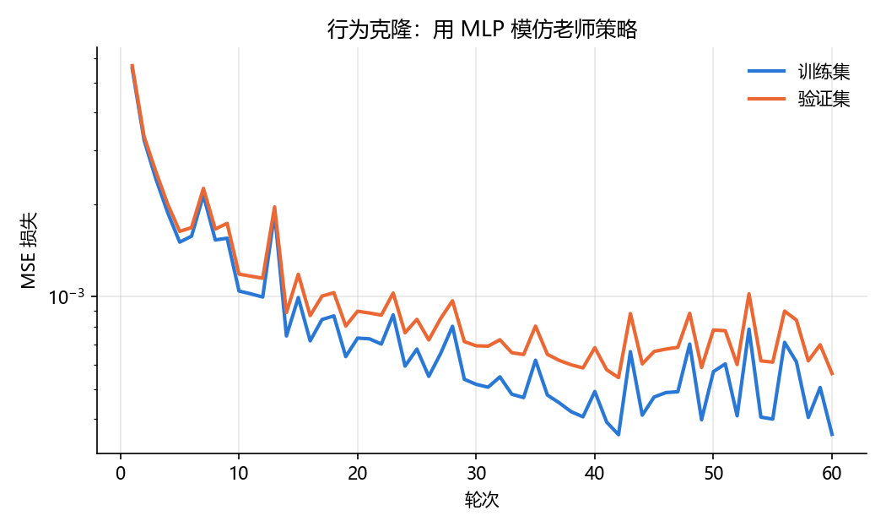
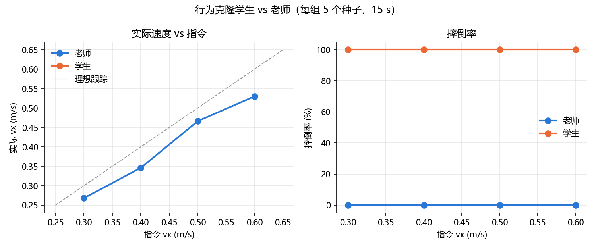

# T800 行为克隆实验报告

## 1. 实验目的

用 PyTorch 训练一个 MLP 学生策略，只靠模仿官方预训练策略（老师）的输入输出，看能不能复现它的行走能力。
这是"自己训练策略"的第一步：先确认学生能学得像，后面（DAgger、抗延迟）才有基础。

老师在延迟实验中的表现是本文的对照基准：0~40 ms 动作延迟下不摔，45 ms 摔倒率 60%，50 ms 及以上全摔。

## 2. 实验条件

| 项目 | 设置 |
|---|---|
| 仿真环境 | MuJoCo 3.4，平地，地面摩擦系数 1.0 |
| 机器人 | T800 人形机器人，25 个关节，整机质量 84.9 kg |
| 老师 | 官方预训练模型 `t800_260318_150533_60000.mnn`，观测 1083 维、动作 22 维 |
| 控制频率 | 策略推理 100 Hz，PD 力矩控制 500 Hz（仿真步长 0.002 s） |
| 控制参数 | 默认站姿、PD 增益、动作缩放、力矩限幅均与官方 SDK 部署配置一致，常量直接取自 [25_t800_robustness.py](25_t800_robustness.py) |
| 学生 | MLP 1083 → 512 → 256 → 22，ELU 激活，MSE 损失，Adam 优化器，学习率 1e-3，批大小 1024 |
| 训练环境 | CPU（PyTorch 2.15.0+cpu），无 GPU |
| 评测 | `run_trial(policy=学生)`，指令 vx = 0.3 / 0.4 / 0.5 / 0.6 m/s，各 5 个种子，每次 15 s |
| 摔倒判断 | 根部高度低于 0.6 m，或机身倾斜超过 45° |

## 3. 方法

### 3.1 采集老师数据（[26_t800_collect.py](26_t800_collect.py)）

让老师在仿真里走，每个推理步记录 `72 维单帧观测 + 22 维动作 + 3 维指令 + 回合编号 + 回合内步数`。
不直接存 1083 维观测，是为了把数据量压到 118 MB（30 万步）而不是 GB 级；训练时再按 15 帧历史拼装。

**为什么需要额外随机化**：25 里的 `run_trial()` 是确定性的，初始扰动只有 ±0.02 rad，
几个步态周期后状态就收敛到同一条轨迹，直接采会得到大量几乎重复的样本。所以每个回合随机化：

| 项目 | 设置 | 理由 |
|---|---|---|
| 速度指令 | vx ~ U(0.3, 0.6) m/s | 速度实验显示 ±0.2 m/s 以内是死区，0.6 m/s 以上跟踪变差 |
| 初始关节角扰动 | ±0.10 rad | 评测用的 0.02 rad 的 5 倍，让开局状态更分散 |
| 途中随机推 | 每回合 0~3 次，40~120 N，方向随机，持续 0.2 s | 抗推实验里侧向 150 N 就到边界，取 120 N 以内保证老师基本不倒 |

采集规模：200 个回合 × 15 s = 298,232 步，用时 310 s，摔倒 2 个回合（1%），文件 118.1 MB。

**数据正确性自检**：用存下来的 72 维帧按拼接规则重建 1083 维观测，再喂给老师，和记录的动作比对，
最大偏差 **0.00e+00**（抽检 4 个回合 × 8 个时刻）。说明训练时的输入构建和采集时完全一致。

### 3.2 训练（[27_t800_bc_train.py](27_t800_bc_train.py)）

- 按**回合**划分训练 / 验证（198 个回合 → 178 / 20），不能按帧随机划分，否则相邻帧几乎一样，验证集会泄漏。
- 摔倒的 2 个回合不参与训练（摔倒前那几帧的动作已经平衡不住了）。
- 训练 267,000 步 / 验证 30,000 步，60 轮，每轮约 13 s，总用时约 12 min（CPU）。
- 只保存验证损失最好的那一轮权重，同时保存训练配置。

（结果见下一节）

## 4. 结果

### 4.1 训练损失

| 轮次 | 1 | 5 | 10 | 20 | 30 | 42 | 60 |
|---|---:|---:|---:|---:|---:|---:|---:|
| 训练 MSE | 5.55e-3 | 1.51e-3 | 1.05e-3 | 7.6e-4 | 6.9e-4 | **5.5e-4** | 5.6e-4 |
| 验证 MSE | 5.67e-3 | 1.63e-3 | 1.19e-3 | 8.7e-4 | 6.9e-4 | **5.5e-4** | 5.6e-4 |

验证损失和训练损失几乎重叠，没有过拟合；最好的一轮是第 42 轮（验证 MSE 5.5e-4，动作 RMSE ≈ 0.023，
不到动作标准差的 3%）。说明**在老师走过的状态上，学生几乎是逐点复现了老师**。

### 4.2 闭环评测：学生自己走

| 指令 vx | 老师实际 vx | 老师摔倒率 | 学生实际 vx | 学生摔倒率 |
|---:|---:|---:|---:|---:|
| 0.3 | 0.268 | 0% | — | 100% |
| 0.4 | 0.346 | 0% | — | 100% |
| 0.5 | 0.466 | 0% | — | 100% |
| 0.6 | 0.530 | 0% | — | 100% |

学生的开环精度很高（MSE 5.5e-4），但一旦让它自己闭环控制，四个速度全部摔倒。
这正是计划里预判的**复合误差（compounding error）**：学生只在老师到过的状态上学过，
一旦偏离一点，它的动作让状态更偏，误差越滚越大。诊断结果和"是复合误差而不是代码问题"的证据见 4.3。
