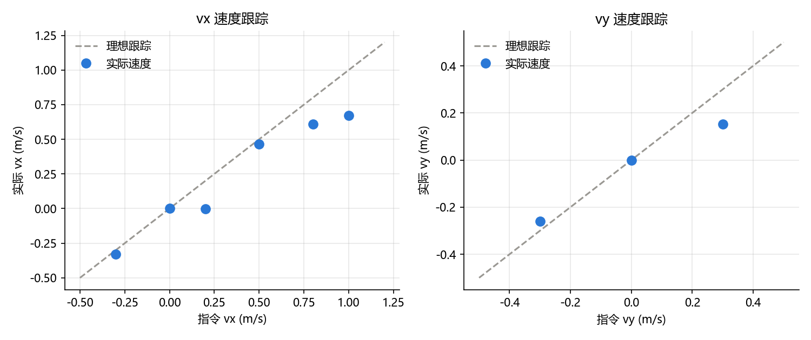
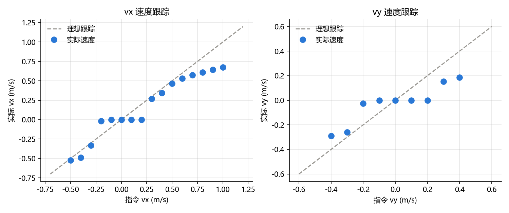

# T800 行走策略速度跟踪实验报告

## 1. 实验目的

测试官方预训练的 RL 行走策略能不能按指令速度行走：给定前进速度 vx 或侧向速度 vy，机器人实际走多快，误差多大，会不会摔倒。

## 2. 实验条件

以下条件在所有测试中保持不变，每次只改变速度指令。

| 项目 | 设置 |
|---|---|
| 仿真环境 | MuJoCo 3.4，平地，地面摩擦系数 1.0 |
| 机器人 | T800 人形机器人，25 个关节，整机质量 84.9 kg |
| 策略 | 官方预训练模型 `t800_260318_150533_60000.mnn`，控制 22 个关节（腰和头锁在默认角） |
| 控制频率 | 策略推理 100 Hz，PD 力矩控制 500 Hz（仿真步长 0.002 s） |
| 控制参数 | 默认站姿、PD 增益、动作缩放、力矩限幅均与官方 SDK 部署配置一致 |
| 航向 | 开启航向闭环，机器人始终朝出发方向（+x）行走，不转弯 |
| 仿真时长 | 每次 15 s，前 3 s 为起步阶段，不计入统计 |
| 实际速度 | 第 3 s 到第 15 s 的位移 ÷ 12 s |
| 跟踪误差 | 实际速度和指令速度之间的距离：√((实际vx − 指令vx)² + (实际vy − 指令vy)²) |
| 重复次数 | 每种指令跑 5 次，取平均。每次初始关节角加 ±0.02 rad 随机扰动，随机种子为 0~4 |
| 摔倒判断 | 根部高度低于 0.6 m，或机身倾斜超过 45° |
| 外部干扰 | 无（不推、不加负载、不加延迟和噪声） |

前进（vx）和侧向（vy）分开测试：测 vx 时 vy = 0，测 vy 时 vx = 0。

评测脚本：[25_t800_robustness.py](25_t800_robustness.py)，运行命令 `python 25_t800_robustness.py speed`。

## 3. 第一版测试：8 种指令

### 3.1 测试点

- 前进：vx = 0、0.2、0.5、0.8、1.0 m/s，后退 vx = −0.3 m/s
- 侧向：vy = +0.3、−0.3 m/s

一共 8 种指令 × 5 次 = 40 次仿真。

### 3.2 结果

图中虚线表示实际速度等于指令速度，圆点离虚线越近，跟踪越准。

| 指令 vx | 指令 vy | 实际 vx | 实际 vy | 跟踪误差 (m/s) | 摔倒率 |
|---:|---:|---:|---:|---:|---:|
| 0.0 | 0.0 | 0.000 | 0.000 | 0.000 | 0% |
| 0.2 | 0.0 | −0.001 | −0.001 | 0.201 | 0% |
| 0.5 | 0.0 | 0.466 | −0.016 | 0.038 | 0% |
| 0.8 | 0.0 | 0.610 | −0.026 | 0.192 | 0% |
| 1.0 | 0.0 | 0.673 | −0.023 | 0.327 | 0% |
| −0.3 | 0.0 | −0.329 | 0.000 | 0.029 | 0% |
| 0.0 | 0.3 | 0.010 | 0.152 | 0.148 | 0% |
| 0.0 | −0.3 | 0.010 | −0.261 | 0.040 | 0% |

### 3.3 第一版的不足

1. **测试点太稀，找不到边界**：vx = 0.2 时机器人不动，0.5 时能走，但从多少开始走，看不出来。0.5 之后实际速度从哪里开始跟不上，也只能靠猜。
2. **侧向只测了两个点**：vy 只测了 ±0.3。+0.3 时实际只有 0.152，−0.3 时实际是 −0.261，左右差得明显，但两个点不足以判断这是普遍规律还是个别情况。
3. **后退只测了一个点**：只有 −0.3 一档，不知道后退时是否也有死区，也不知道后退能退多快。

## 4. 第二版测试：24 种指令

### 4.1 调整方案

把测试点加密为每 0.1 m/s 一档，其他条件全部不变：

- 前进 / 后退：vx 从 −0.5 到 1.0 m/s，共 16 档
- 侧向：vy 从 −0.4 到 0.4 m/s（去掉 0），共 8 档

一共 24 种指令 × 5 次 = 120 次仿真，用时 108 s。

### 4.2 结果

**前进 / 后退（vy = 0）**

| 指令 vx | 实际 vx | 实际 vy | 跟踪误差 (m/s) | 实际 / 指令 | 摔倒率 |
|---:|---:|---:|---:|---:|---:|
| −0.5 | −0.524 | −0.052 | 0.057 | 105% | 0% |
| −0.4 | −0.489 | −0.005 | 0.089 | 122% | 0% |
| −0.3 | −0.329 | 0.000 | 0.029 | 110% | 0% |
| −0.2 | −0.018 | −0.004 | 0.182 | 9% | 0% |
| −0.1 | 0.000 | −0.001 | 0.100 | 0% | 0% |
| 0.0 | 0.000 | 0.000 | 0.000 | — | 0% |
| 0.1 | 0.000 | 0.000 | 0.100 | 0% | 0% |
| 0.2 | −0.001 | −0.001 | 0.201 | 0% | 0% |
| 0.3 | 0.268 | 0.008 | 0.033 | 89% | 0% |
| 0.4 | 0.346 | 0.011 | 0.055 | 87% | 0% |
| 0.5 | 0.466 | −0.016 | 0.038 | 93% | 0% |
| 0.6 | 0.530 | −0.029 | 0.075 | 88% | 0% |
| 0.7 | 0.574 | −0.033 | 0.130 | 82% | 0% |
| 0.8 | 0.610 | −0.026 | 0.192 | 76% | 0% |
| 0.9 | 0.644 | −0.030 | 0.258 | 72% | 0% |
| 1.0 | 0.673 | −0.023 | 0.327 | 67% | 0% |

**侧向（vx = 0）**

| 指令 vy | 实际 vx | 实际 vy | 跟踪误差 (m/s) | 实际 / 指令 | 摔倒率 |
|---:|---:|---:|---:|---:|---:|
| −0.4 | 0.008 | −0.290 | 0.110 | 73% | 0% |
| −0.3 | 0.010 | −0.261 | 0.040 | 87% | 0% |
| −0.2 | 0.001 | −0.025 | 0.175 | 13% | 0% |
| −0.1 | 0.000 | 0.000 | 0.100 | 0% | 0% |
| 0.1 | 0.000 | 0.000 | 0.100 | 0% | 0% |
| 0.2 | 0.000 | 0.000 | 0.200 | 0% | 0% |
| 0.3 | 0.010 | 0.152 | 0.148 | 51% | 0% |
| 0.4 | 0.015 | 0.187 | 0.213 | 47% | 0% |

完整数据见 [results/speed.csv](results/speed.csv)，第一版数据见 [results/speed_v1.csv](results/speed_v1.csv)。

## 5. 结论

1. **存在约 ±0.25 m/s 的指令死区**：前进、后退、侧向三个方向，指令绝对值不超过 0.2 m/s 时，机器人都原地踏步，实际速度几乎为 0。指令到 ±0.3 m/s 才开始移动。死区的确切边界在 0.2 和 0.3 之间，要确定的话，需要在这个区间按 0.01 m/s 再加密测试。
2. **前进的有效范围是 0.3~0.6 m/s**：这个范围内实际速度达到指令的 87%~93%，跟踪误差不超过 0.075 m/s。超过 0.6 m/s 后实际速度明显跟不上，指令 1.0 m/s 时只走到 0.673 m/s（67%）。前进的实际最高速度大约在 0.67 m/s。
3. **后退会略快于指令**：−0.3 到 −0.5 m/s 之间，实际速度是指令的 105%~122%，误差在 0.09 m/s 以内。
4. **侧向左右不对称**：向右（vy 为负）能达到指令的 73%~87%，向左（vy 为正）只有 47%~51%。向左的能力大约是向右的一半。
5. **全部 24 种指令下都没有摔倒**：在平地、无干扰的条件下，这个速度范围内策略是稳定的。
6. **前进时有轻微侧向漂移**：vx ≥ 0.5 m/s 时，实际 vy 约为 −0.02~−0.03 m/s，机器人会慢慢向右偏，但幅度很小。

### 可能的原因（待验证）

- **死区**：训练时可能把小于某个值的速度指令当作"站立"处理，策略学会了在小指令下原地踏步。可以查训练或 SDK 配置里有没有类似的指令下限参数。
- **前进速度上限**：训练时的速度指令范围可能只覆盖到 0.6~0.7 m/s 左右，超出训练范围后，策略不知道该怎么走得更快。
- **左右不对称**：可能是模型本身左右质量分布不对称，也可能是策略训练时左右不均衡。前面的抗推实验里也出现了左右不对称，向左推可承受 300 N，向右推只有 150 N，两者可以放在一起分析。

### 本实验的局限

- 只在平地、默认摩擦、无干扰的条件下测试。
- 每种指令 5 次重复，报告的是平均值，没有统计每次之间的差异。
- 只测了单一方向的速度，没有测 vx 和 vy 同时不为 0 的斜向行走，也没有测转弯。
- 只在仿真中测试，没有在真机上验证。
